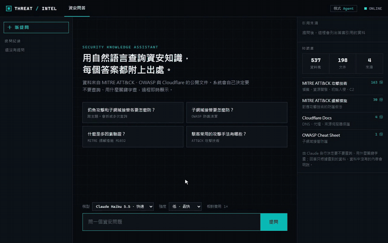
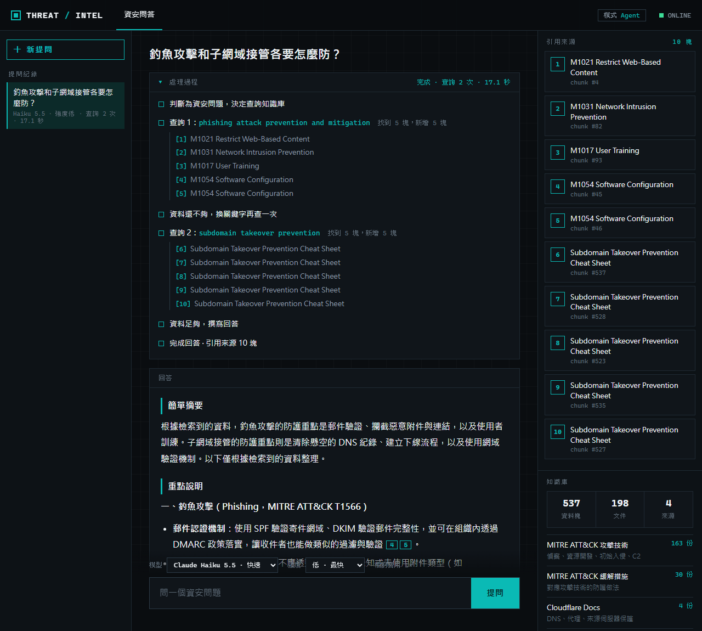
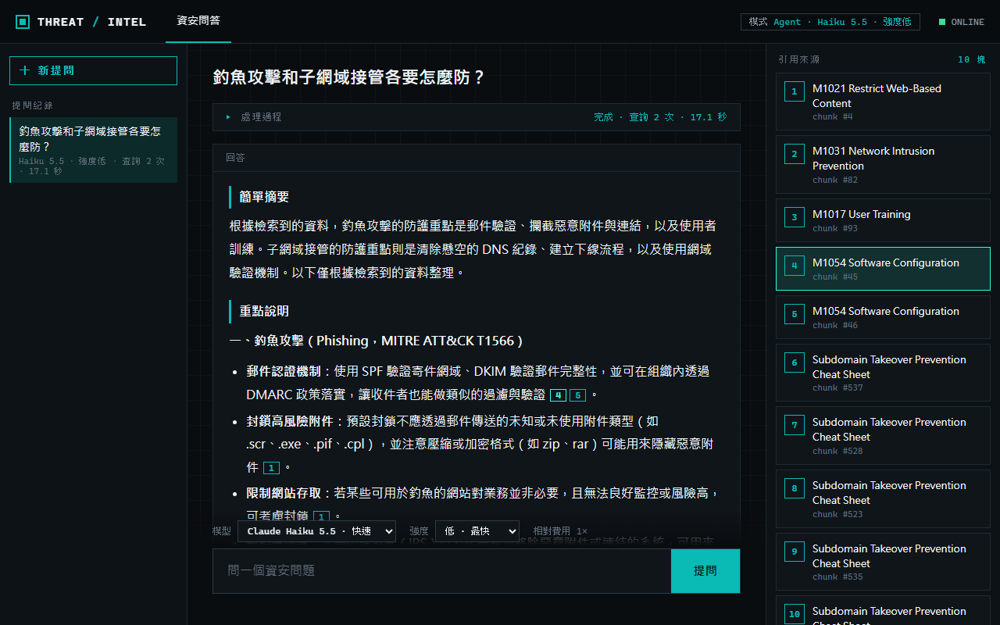
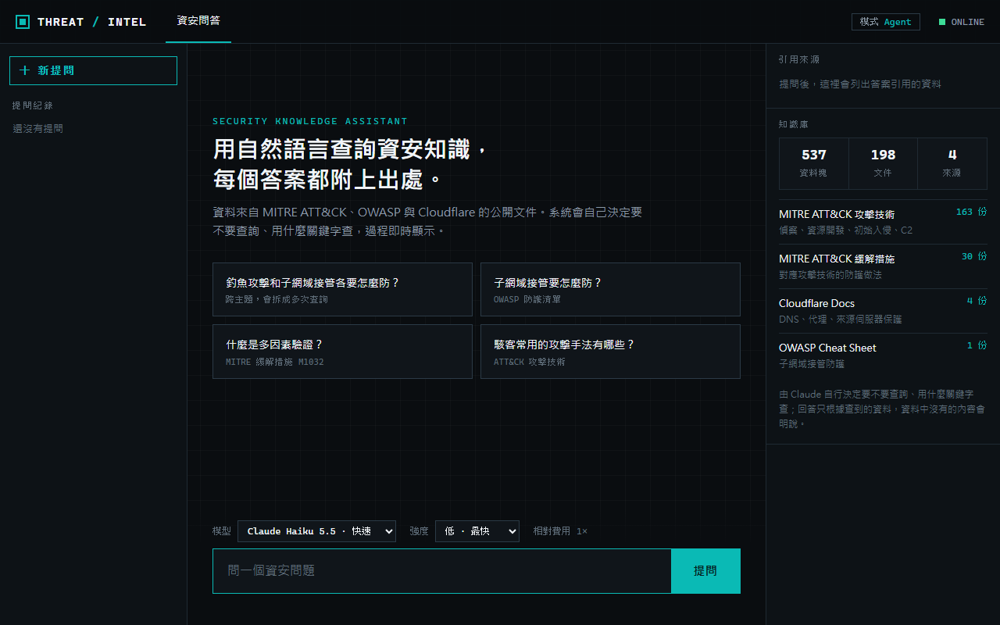
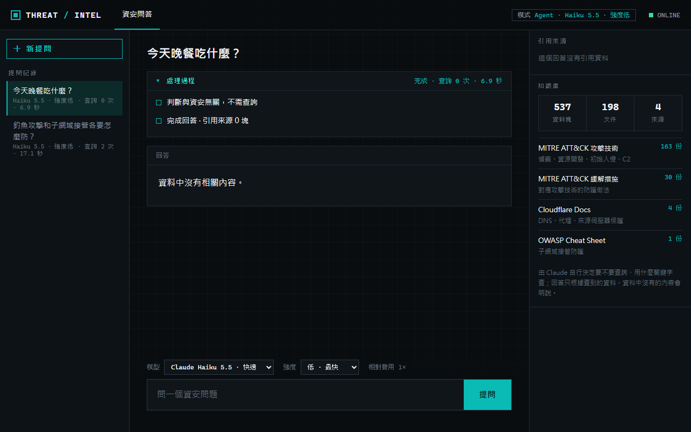
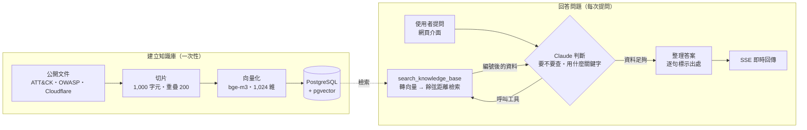
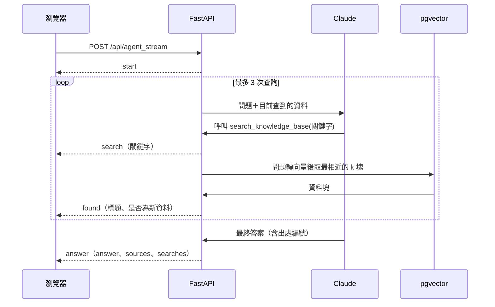
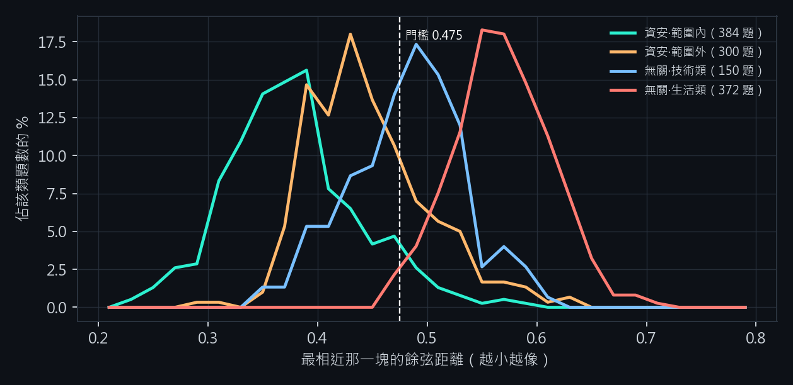
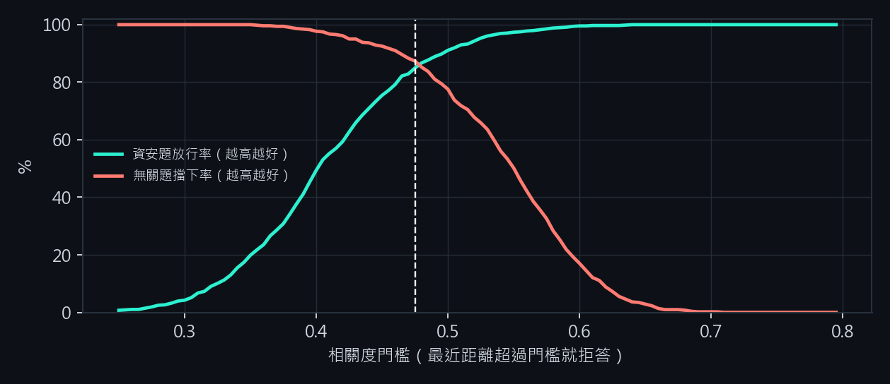
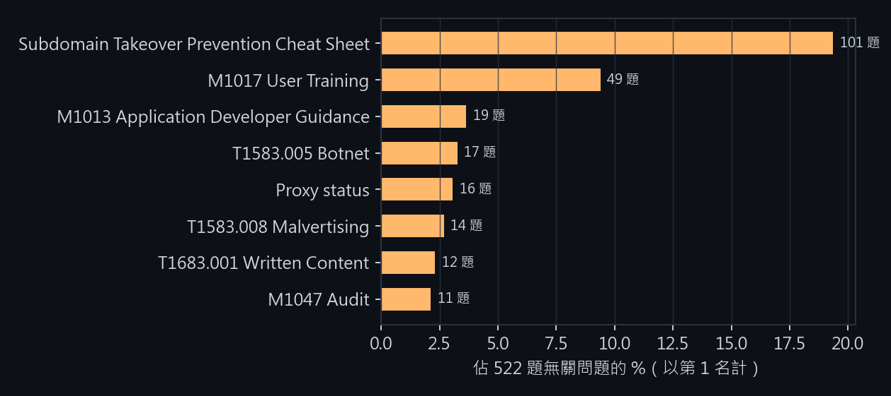

# Threat Intel｜資安知識問答系統

以 **檢索增強生成（RAG）** 與 **AI Agent** 打造的資安知識助理：用自然語言提問，系統從公開資安文件找出依據、整理成繁體中文答案，並在每一句標示可點選的出處。




> 完整操作影片（1 分 10 秒）：[docs/demo.mp4](docs/demo.mp4)

---

## 重點一覽

| 項目 | 內容 |
|---|---|
| 解決的問題 | 一般 AI 對話可能憑空捏造資安細節；本系統的答案只根據查到的文件，並附上可核對的出處 |
| 知識來源 | MITRE ATT&CK（攻擊技術、緩解措施）、OWASP Cheat Sheet、Cloudflare Docs，共 **198 份文件、537 個資料塊** |
| 問答方式 | **AI Agent 自主查詢**：模型判斷要不要查、用什麼關鍵字、資料夠不夠，不夠就換關鍵字再查（最多 3 次） |
| 即時過程 | 後端以 SSE 串流送出每一步，畫面即時顯示查詢關鍵字與命中的資料 |
| 檢索評測 | **1,206 題**（資安相關與無關各半），以最近距離區分兩類的 **AUC = 0.926** |
| 其他功能 | 可點選的引用卡片、提問紀錄、可切換模型（Haiku／Sonnet／Opus）與思考強度、無關問題直接拒答 |

## 畫面

| Agent 即時處理過程 | 答案與引用出處 |
|---|---|
|  |  |
| 跨主題問題自動拆成兩次查詢，每次命中的資料都列出 | 點選答案中的編號，右側對應的引用卡片會亮起 |

| 首頁 | 無關問題直接拒答 |
|---|---|
|  |  |
| 左側提問紀錄、中間問答、右側引用與知識庫統計 | 模型判斷與資安無關，查詢 0 次，回覆「資料中沒有相關內容」 |

## 系統架構



> 「Claude 判斷」與「查詢工具」之間會依模型判斷反覆執行；模型呼叫上限 4 次（最多 3 次查詢＋1 次回答），避免無限迴圈。

---

## 詳細說明

點選標題展開。

<details>
<summary><b>技術棧</b></summary>

| 元件 | 技術 | 負責的事 |
|---|---|---|
| 後端 API | FastAPI（非同步）、Pydantic | 提供檢索、問答、串流問答 API；驗證輸入格式 |
| 資料庫 | PostgreSQL 16＋pgvector、SQLAlchemy 2.0（async）、psycopg 3 | 儲存資料塊與向量；以餘弦距離找出最相近的資料 |
| 向量模型 | Ollama 執行 bge-m3（本機） | 把文件與問題轉成 1,024 維向量 |
| 語言模型 | Anthropic Claude（Haiku／Sonnet／Opus 5.5） | 判斷是否查詢、產生查詢關鍵字、撰寫答案 |
| Agent 迴圈 | Anthropic SDK 的 Tool Runner（`client.beta.messages.tool_runner`） | 處理「模型要求工具 → 執行 → 回傳結果」的來回 |
| 切片 | LangChain Text Splitters（`RecursiveCharacterTextSplitter`） | 依段落、換行、句號的優先順序切分 |
| 前端 | 單一 HTML 檔（`static/index.html`），不需建置 | 問答畫面、即時過程、引用卡片、提問紀錄 |
| 部署 | Docker Compose | 後端與資料庫各一個容器，一行指令啟動 |

</details>

<details>
<summary><b>知識庫</b>：來源、切片方式與品質檢查</summary>

### 來源

| 來源 | 內容 | 文件數 | 資料塊 | 授權 |
|---|---|---:|---:|---|
| MITRE ATT&CK | 攻擊技術（偵察、資源開發、初始入侵、C2） | 163 | 289 | MITRE 授權，保留版權聲明 |
| MITRE ATT&CK | 緩解措施 | 30 | 179 | 同上 |
| Cloudflare Docs | DNS、代理、來源伺服器保護 | 4 | 36 | CC BY 4.0 |
| OWASP Cheat Sheet | 子網域接管防護 | 1 | 33 | CC BY-SA 4.0 |
| **合計** | | **198** | **537** | |

只收錄授權允許轉載的公開文件，來源與授權記錄在 [`data/corpus/LICENSES.md`](data/corpus/LICENSES.md)；整理後的文件在 `data/corpus/*.jsonl`（每行一份文件）。

### 處理方式

| 步驟 | 做法 |
|---|---|
| 切片 | 依段落 → 換行 → 句號的優先順序切分，每塊約 1,000 字元、前後重疊 200 字元，並在每塊開頭補上所屬文件的標題，讓向量知道這塊屬於哪份文件 |
| 向量化 | 透過 Ollama 執行 bge-m3，每批 20 筆產生 1,024 維向量 |
| 寫入檢查 | 寫入前確認文字與向量筆數一致；完成後核對共 537 筆、無重複 |
| 切片品質 | 逐塊檢查切點：23 塊的結尾停在標題上，其中 18 塊已透過重疊帶入下一塊，實際受影響的只有少數幾塊 |

</details>

<details>
<summary><b>Agent 運作方式</b>：與固定流程的差異</summary>

系統給模型一個工具 `search_knowledge_base(query)`。模型讀完問題後，自己決定要不要呼叫它、傳入什麼英文關鍵字（知識庫為英文文件）；程式負責實際執行檢索，把結果去重、接續編號後交回模型，直到模型判斷資料足夠、寫出答案。



### 設計重點

| 項目 | 做法 |
|---|---|
| 回答規則 | 系統提示詞規定只依查到的資料回答、使用繁體中文、每句標示出處編號；問到「最常見、排名」這類程度問題時，資料沒有統計就要明說 |
| 防止無限迴圈 | 模型呼叫次數上限 4 次（最多 3 次查詢加 1 次回答） |
| 引用編號 | 跨多次查詢去重後接續編號，答案中的 `[n]` 與來源一一對應 |
| 錯誤處理 | 工具內的例外自動轉成 `is_error` 回給模型；向量模型無法使用回 503、語言模型無法使用回 502；串流進行中改以 `error` 事件通知前端 |
| 費用控制 | 模型與思考強度只接受白名單內的值，不合規格直接回 422，避免任意指定模型造成費用失控 |

### 固定流程 vs Agent

| 比較項目 | 固定流程（`rag-fixed-pipeline` 分支） | Agent（目前 `main`） |
|---|---|---|
| 是否檢索 | 每次都檢索 | 模型判斷；與資安無關的問題不查詢 |
| 查詢用字 | 使用者原句 | 模型產生的英文關鍵字 |
| 查詢次數 | 固定 1 次 | 依需要 0 到 3 次，資料不夠會換關鍵字再查 |
| 過程可見度 | 只看到結果 | 每一步即時顯示在畫面上 |

固定流程版本保留在 [`rag-fixed-pipeline`](https://github.com/cbes502034/threat-intel-mine/tree/rag-fixed-pipeline) 分支，可與目前版本並排執行、用同一題比較。

</details>

<details>
<summary><b>API</b>：路由、請求與回傳格式、SSE 事件</summary>

### 路由

| 方法 | 路徑 | 說明 | 呼叫 Claude |
|---|---|---|:---:|
| GET | `/api/health` | 健康檢查，回 200 時畫面右上角顯示 ONLINE | |
| POST | `/api/search` | 只檢索，回傳最相近的資料片段（除錯與評測用） | |
| POST | `/api/ask` | 固定流程問答：檢索一次 → 組提示詞 → 生成答案 | ✔ |
| POST | `/api/agent_ask` | Agent 問答，一次回傳完整結果 | ✔ |
| POST | `/api/agent_stream` | Agent 問答，以 SSE 串流回傳每一步（畫面使用這個） | ✔ |

### 請求

```json
{
  "question": "釣魚攻擊和子網域接管各要怎麼防？",
  "top_k": 5,
  "model": "claude-haiku-5-5",
  "effort": "low"
}
```

| 欄位 | 必填 | 規則 |
|---|:---:|---|
| `question` | ✔ | 1 到 500 字 |
| `top_k` | | 每次檢索取幾塊，1 到 10，預設 5 |
| `model` | | `claude-haiku-5-5`（預設）、`claude-sonnet-5-5`、`claude-opus-5-5` |
| `effort` | | `low`（預設）、`medium`、`high` |

### 回傳（`/api/agent_ask`）

```json
{
  "question": "釣魚攻擊和子網域接管各要怎麼防？",
  "answer": "……郵件認證機制……[4][5]……",
  "sources": [{"ref": 1, "id": 4, "title": "M1021 Restrict Web-Based Content"}],
  "searches": ["phishing attack prevention and mitigation", "subdomain takeover prevention"]
}
```

### SSE 事件（`/api/agent_stream`）

每一筆為 `data: {JSON}\n\n`，依 `type` 區分：

| type | 時機 | 主要欄位 |
|---|---|---|
| `start` | 開始處理 | `question` |
| `search` | 模型決定查詢 | `query` |
| `found` | 查詢完成 | `query`、`results[]`（`ref`、`title`、`new`） |
| `search_error` | 該次查詢失敗（模型會收到錯誤並自行決定下一步） | `query` |
| `answer` | 完成 | `answer`、`sources`、`searches` |
| `error` | 發生錯誤 | `status`、`detail` |

### 錯誤狀態碼

| 狀態碼 | 情況 |
|---|---|
| 400 | 問題是空白 |
| 422 | 格式不對：超過 500 字、`top_k` 超出範圍、不在白名單內的模型或強度 |
| 502 | 語言模型（Claude）暫時無法使用 |
| 503 | 向量模型（Ollama）暫時無法使用 |

更多前後端約定見 [`API合約.md`](API合約.md)。

</details>

<details>
<summary><b>快速開始</b>：本機執行步驟</summary>

### 需要的環境

- Docker Desktop
- [Ollama](https://ollama.com/)，並下載向量模型：

```bash
ollama pull bge-m3
```

- Anthropic API 金鑰

### 1. 建立 `.env`（不要提交到 Git）

```env
ANTHROPIC_API_KEY=你的金鑰
DB_HOST=db
DB_PORT=5432
DB_NAME=thread_intel_mine
DB_USER=postgres
DB_PASSWORD=與 compose.yml 中 POSTGRES_PASSWORD 相同
```

選填：`LLM_PROVIDER=ollama` 可改用本機模型生成答案（模型名稱見 `compose.yml` 的 `OLLAMA_MODEL`），預設為 `claude`。

### 2. 啟動服務

```bash
docker compose up -d --build
```

### 3. 建立資料表（只需一次）

```bash
docker compose exec backend python scripts/create_tables.py
```

### 4. 建立向量索引

```bash
docker compose exec backend python -m scripts.build_index
```

537 塊在無獨立顯卡的筆電上約需 8 分鐘。重跑前要先清表（`TRUNCATE chunks RESTART IDENTITY`），否則會重複寫入。

### 5. 開啟畫面

瀏覽 <http://localhost:8000>。

> 知識庫文件已整理好放在 `data/corpus/`。若要從原始來源重新下載（ATT&CK 原檔約 55MB），執行 `python scripts/build_knowledge.py`。

</details>

<details>
<summary><b>專案結構</b></summary>

```text
threat-intel-mine/
├── app/
│   ├── main.py               # 路由與靜態檔掛載
│   ├── services.py           # 各路由的處理邏輯（含 SSE 串流）
│   ├── config.py             # 環境變數集中讀取
│   ├── base.py               # 資料庫連線（SQLAlchemy async）
│   ├── models.py             # chunks 資料表（content＋1,024 維向量）
│   ├── crud.py               # 資料庫存取
│   ├── verification/
│   │   └── format.py         # 請求格式驗證（Pydantic）
│   └── agent/
│       ├── orchestrator.py   # 檢索與 Agent 迴圈（Tool Runner、SSE 事件）
│       ├── LLM.py            # 系統提示詞、Claude／Ollama 呼叫
│       └── RAG/
│           ├── chunker.py    # 切片
│           ├── embeding.py   # bge-m3 向量化
│           └── prompt.py     # 組裝提示詞
├── scripts/
│   ├── build_knowledge.py    # 下載並整理知識庫來源
│   ├── create_tables.py      # 建立資料表
│   ├── build_index.py        # 切片 → 向量化 → 寫入資料庫
│   ├── make_eval_questions.py# 產生檢索評測問題集
│   └── analyze_retrieval.py  # 檢索評測與分析
├── data/
│   ├── corpus/               # 知識庫文件（JSONL）＋ LICENSES.md
│   └── eval/                 # 評測問題集與結果
├── static/index.html         # 前端畫面（單檔）
├── db/init.sql               # 啟用 pgvector
├── docs/                     # README 用的截圖、圖表與影片
├── compose.yml
└── Dockerfile
```

</details>

<details>
<summary><b>測試與評測</b>：檢索評測、Agent 實測、API 與畫面驗證</summary>

### 一、檢索評測（1,206 題）

檢驗「檢索能不能分辨資安問題與無關問題」。只做檢索（轉向量＋查資料庫），不呼叫 Claude、不花額度。

| 類別 | 子類別 | 題數 | 最近距離中位數 | 說明 |
|---|---|---:|---:|---|
| 資安 | 範圍內 `in_scope` | 384 | 0.373 | 知識庫有收錄的主題 |
| 資安 | 範圍外 `out_of_scope` | 300 | 0.436 | 資安相關，但知識庫沒收 |
| 無關 | 技術類 `tech` | 150 | 0.487 | 一般資訊技術，刻意挑較貼近的題目 |
| 無關 | 生活類 `life` | 372 | 0.567 | 生活、學習、興趣 |

- 語言：中文 865 題、英文 341 題；每個主題固定抽 6 種問法，方便比較主題與問法的影響。
- 以最近距離區分「資安」與「無關」：**AUC = 0.926**。
- 門檻 0.475 時：資安題放行 84.9%、無關題擋下 87.4%。

| 距離分布 | 門檻取捨 |
|---|---|
|  |  |
| 範圍內（青）最靠左、生活類（紅）最靠右，技術類與範圍外落在中間 | 門檻越高放行越多資安題，也漏過越多無關題，兩線約在 0.475 交會 |



> 無關問題共命中 87 份不同文件，前 5 名佔 39%：少數文件會「吸走」大量無關問題，是後續調整的方向。另一個發現是中文問題的距離普遍比英文大。

**問題集範例**（完整見 [`data/eval/questions.jsonl`](data/eval/questions.jsonl)）

| 子類別 | 範例 |
|---|---|
| 範圍內 | 如何預防路過式下載？ |
| 範圍外 | 攻擊者如何利用跨站請求偽造？ |
| 技術類 | 軟體測試的步驟是什麼？ |
| 生活類 | What kinds of camping are there? |

**評測工具**

| 檔案 | 用途 |
|---|---|
| [`scripts/make_eval_questions.py`](scripts/make_eval_questions.py) | 依「主題 × 問法」產生問題集，輸出 `data/eval/questions.jsonl` |
| [`scripts/analyze_retrieval.py`](scripts/analyze_retrieval.py) | 逐題檢索並統計距離分布、AUC、被過度命中的文件、主題／語言／問法的影響 |
| [`data/eval/results.csv`](data/eval/results.csv) | 每一題的前 3 名結果與距離 |
| [`檢索與問答測試報告.pdf`](檢索與問答測試報告.pdf) | 完整測試報告（7 頁），含方法、數據與建議 |

```bash
python scripts/make_eval_questions.py
docker compose exec backend python scripts/analyze_retrieval.py
```

### 二、Agent 實測（皆為實際呼叫結果，模型 Haiku、強度 low）

| 問題 | 查詢次數與關鍵字 | 耗時 | 結果 |
|---|---|---:|---|
| 什麼是多因素驗證？ | 1 次：multi-factor authentication | 6.4 秒 | 引用 5 塊，編號全部對得上 |
| 今天晚餐吃什麼？ | 0 次（判斷與資安無關） | 0.7～6.9 秒 | 直接回答「資料中沒有相關內容」 |
| 駭客常用的攻擊手法有哪些？ | 2 次：先查通用攻擊技術，再換成憑證竊取、勒索軟體 | 10.0 秒 | 引用 9 塊；說明資料沒有頻率統計 |
| 釣魚攻擊和子網域接管各要怎麼防？ | 2 次：phishing…、subdomain takeover… | 11～17 秒 | 兩個主題都查到資料 |

同一題「釣魚攻擊和子網域接管各要怎麼防？」交給固定流程版本時只檢索一次，5 塊資料都來自子網域接管文件，釣魚的部分答不出來；Agent 版會拆成兩次查詢。這是兩種做法差異最明顯的例子。

### 三、其他驗證

| 項目 | 結果 |
|---|---|
| 模型切換 | 分別指定 Haiku、Sonnet、Opus，確認 Claude 實際回覆的模型與指定一致 |
| API 驗證 | 空白問題回 400；格式錯誤、未允許的模型或強度回 422 |
| 畫面 | 手機（375）、平板（768）、桌面（1280）三種寬度都沒有版面溢出 |

</details>

<details>
<summary><b>版本演進</b></summary>

| 階段 | 做法 | 改進的原因 |
|---|---|---|
| 第一版　Threat Intel Agent | 輸入 IP 或網域，Agent 以 Tool Use 串接 WHOIS、IPWHOIS、AbuseIPDB、VirusTotal 四個情資來源，產出結構化風險報告 | 只能查單一目標，用途窄，答案也無法對回出處 |
| 第二版　固定流程 RAG | 建立資安知識庫；問題轉成向量後檢索一次，把結果交給模型回答並標示出處 | 跨主題或用字較廣的問題，只檢索一次容易漏掉資料 |
| 第三版　Agentic RAG（目前） | 把檢索包成工具交給模型，由模型決定要不要查、怎麼查、查幾次；過程以串流即時顯示 | 跨主題問題會拆成多次查詢 |

</details>

<details>
<summary><b>開發方式與分工</b></summary>

開發方式是「我先決定方向與規格，AI 協助設計細節與實作，我負責實作核心並驗收」。

| 項目 | 我負責 | AI 協助 |
|---|---|---|
| 方向與規格 | 決定專案定位（從 IP 查證改為資安知識問答）、採用 Agent、單一查詢工具、保留舊版對照、加入模型切換 | 提供做法比較與優缺點分析 |
| 資料與檢索 | 切片器、向量化、資料表設計、資料庫存取、建立索引 | 檢查切片品質與資料完整性 |
| 問答與 Agent | 提示詞規則、組裝提示詞、Agent 迴圈與串流的後端程式 | 提供設計說明與程式導引、找出錯誤 |
| 介面與測試 | 定義介面需求、驗收 | 前端畫面、評測腳本、測試報告 |

</details>

<details>
<summary><b>已知限制與後續規劃</b></summary>

### 已知限制

- 知識庫只涵蓋 ATT&CK 的偵察、資源開發、初始入侵、C2 四個戰術與緩解措施，以及子網域接管、Cloudflare DNS 相關文件；範圍外的問題會回覆資料中沒有。
- 中文問題的檢索距離普遍比英文大；Agent 版以模型產生英文關鍵字來緩解。
- 目前每次提問獨立處理，不保留前幾輪對話。

### 後續規劃

| 方向 | 內容 |
|---|---|
| 擴充知識領域 | 加入 MITRE ATT&CK for ICS，補上工控與製造業（OT）的資安知識 |
| 量化答案品質 | 建立有標準答案的題組，量測檢索命中率與答案正確率，並檢查引用是否真的支持該句內容 |
| 連續對話 | 保留前幾輪對話，讓使用者可以追問 |
| 更多工具 | 依編號精確查詢、依戰術列出技術、查詢攻擊對應的緩解措施，讓 Agent 有更多可選擇的做法 |

</details>

---

## 授權與資料來源

知識庫內容來自 MITRE ATT&CK®、OWASP Cheat Sheet Series 與 Cloudflare Docs，各依其授權使用，詳見 [`data/corpus/LICENSES.md`](data/corpus/LICENSES.md)。MITRE ATT&CK® 為 The MITRE Corporation 的註冊商標。
